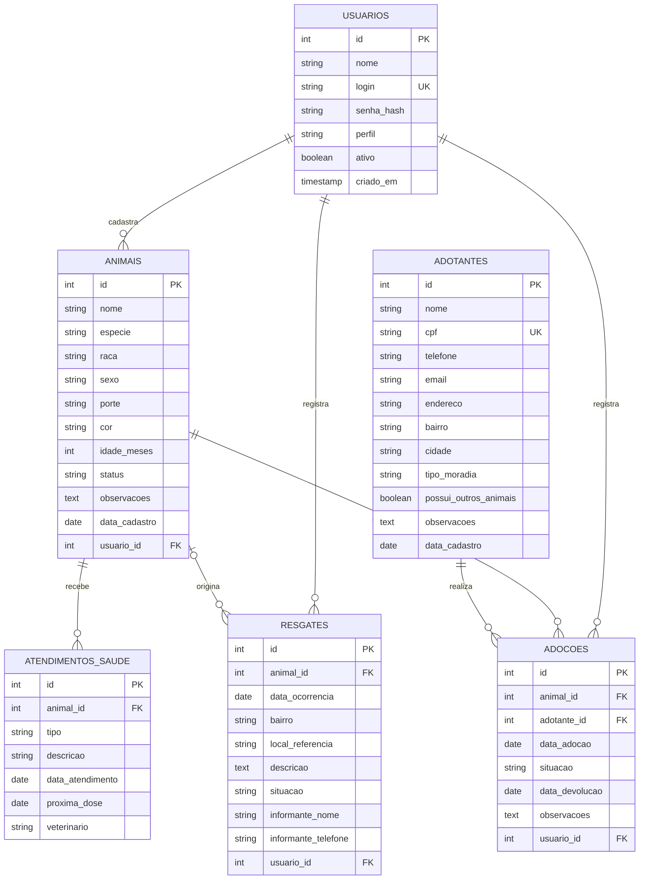

# Diagrama Entidade-Relacionamento

Banco: `animais_pontes_lacerda` (script em [`banco/schema.sql`](../banco/schema.sql)).

## Relacionamentos

| Relação | Cardinalidade | Explicação |
|---------|---------------|------------|
| usuarios → animais | 1:N | cada animal é cadastrado por um usuário |
| usuarios → resgates | 1:N | cada ocorrência é registrada por um usuário |
| usuarios → adocoes | 1:N | cada adoção é registrada por um usuário |
| animais → atendimentos_saude | 1:N | um animal tem vários atendimentos (vacinas, castração...) |
| animais → resgates | 1:N (opcional) | a ocorrência só aponta para um animal depois do resgate |
| animais → adocoes | 1:N | um animal pode ser adotado, devolvido e readotado |
| adotantes → adocoes | 1:N | um adotante pode adotar mais de um animal |

`adocoes` é a tabela associativa entre `animais` e `adotantes` (relação N:N com atributos próprios: data, situação e devolução).
